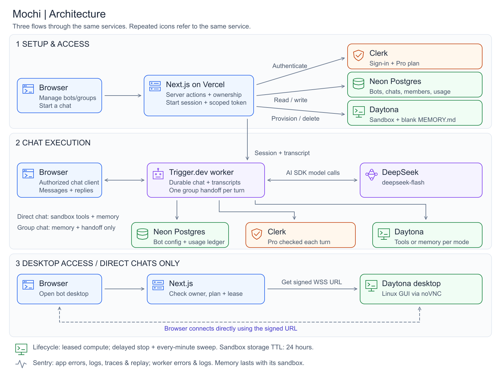

#  Mochi

Mochi is an AI agent workspace for creating bots, chatting with them individually or in groups, and giving them tools to work inside isolated cloud sandboxes. Each bot has its own instructions, avatar, and sandbox-backed memory. Agents can run shell commands, work with files, and interact with a Linux desktop that users can view through the browser.

The app uses Next.js and React for the interface, Clerk for authentication and subscriptions, Neon PostgreSQL with Drizzle for application data, Trigger.dev for durable agent execution, DeepSeek through the AI SDK for model calls, and Daytona for sandbox compute. Sentry monitors the app and workers.

## Prerequisites and how to run

### Prerequisites

- Node.js 24 and npm. The Trigger.dev worker is configured for Node.js 24.
- A Clerk application with a `pro` subscription plan. Bot creation, chat, and sandbox access require Pro; the worker also verifies the subscription period.
- A Neon PostgreSQL database with pooled and direct connection URLs.
- A Trigger.dev project, a development environment key, and CLI access to that project.
- DeepSeek and Daytona API keys, with access to sandbox compute and desktop functionality.

This checkout is configured for the existing Mochi Trigger.dev project in `trigger.config.ts`. If running your own installation, replace that project reference and configure your own Sentry project and DSNs.

### Install and configure

```bash
git clone https://github.com/taufiq0205/mochi.git
cd mochi
npm ci
cp .env.example .env.local
```

For an existing checkout, keep your current `.env.local`. Fill in these values from the matching development services:

| Variable | Purpose |
| --- | --- |
| `NEXT_PUBLIC_CLERK_PUBLISHABLE_KEY` | Clerk's public development key |
| `CLERK_SECRET_KEY` | Server-side Clerk access |
| `DATABASE_URL` | Pooled Neon URL for application and worker queries |
| `DATABASE_URL_UNPOOLED` | Direct Neon URL for Drizzle schema changes |
| `DEEPSEEK_API_KEY` | Model access |
| `DAYTONA_API_KEY` | Sandbox creation and operations |
| `TRIGGER_SECRET_KEY` | Trigger.dev development environment key |
| `SENTRY_AUTH_TOKEN` | Optional build-time source-map upload token |

Keep the Clerk route defaults from `.env.example`. Use `sslmode=verify-full` in the database URLs. Store secrets only in ignored environment files or provider environment settings; never prefix secrets with `NEXT_PUBLIC_`.

Apply the schema to the intended development database:

```bash
npm run db:push
npm run db:check
```

Schema changes use Drizzle push only; do not generate or run migrations. Review destructive changes before applying them. `db:push` targets `DATABASE_URL_UNPOOLED`.

### Start the app and worker

Run the Next.js app in one terminal:

```bash
npm run dev
```

Run the matching Trigger.dev CLI in another terminal:

```bash
npx trigger.dev@4.8.1 login
npx trigger.dev@4.8.1 dev start --env-file .env.local
```

Open [localhost:3000](http://localhost:3000), sign up, and activate a Pro subscription through your Clerk billing setup before creating bots or starting agent chats. Keep both processes running: the web app handles the interface and authorization, while the Trigger worker executes agent turns and sandbox lifecycle tasks.

For a local production build:

```bash
npm run build
npm run start
```

Deploy Trigger workers separately from the Next.js app. Hosted workers need `DATABASE_URL`, `CLERK_SECRET_KEY`, `DEEPSEEK_API_KEY`, and `DAYTONA_API_KEY` for the matching environment. Preserve deployed Trigger credentials: a local development `TRIGGER_SECRET_KEY` must never replace a production key. Disable environment auto-sync when deploying workers to avoid overwriting their existing credentials. Set `SENTRY_AUTH_TOKEN` in each build environment that uploads source maps.

### Checks

```bash
npm run typecheck
npm run lint
node scripts/check-sentry.mjs
```

With the app running, `node scripts/check-auth.mjs` checks signed-out access. `npm run db:check` checks the live database connection. The Sentry script uses stubs; it does not prove live telemetry delivery.

## Architecture



[SVG diagram](docs/project-architecture.svg) · [Editable Excalidraw source](docs/project-architecture.excalidraw)

1. **Setup and access.** The browser talks to Next.js Server Actions. Clerk authenticates requests and checks Pro access; Drizzle stores user-owned bots, chats, group membership, and usage records in Neon. Creating a bot provisions a private Daytona sandbox and initializes its `MEMORY.md`.
2. **Agent execution.** Next.js authorizes access to a chat and issues scoped Trigger.dev session tokens. The browser streams chat through Trigger.dev; the durable `chat-agent` worker calls DeepSeek through the AI SDK and executes sandbox tools. Group chats support bot selection and handoff between members.
3. **Desktop access.** Server-side authorization provides a signed desktop URL. The browser connects directly to Daytona's Linux desktop through noVNC.

Usage admission reserves AI and sandbox allowances before provider work. Delayed stop tasks, a scheduled sweep, and sandbox TTLs bound compute and storage. Bot memory lives in its sandbox and expires with it; it is not indefinite storage. See [usage and billing](docs/usage-billing.md) for limits, accounting, and lifecycle details.

Sentry captures app and worker errors and structured logs. Logs omit chat content, tool arguments/results, credentials, and signed URLs. Trigger.dev retains ownership of worker OpenTelemetry; source maps are configured for both app and worker builds.

## Future work

- **Hindsight memory:** integrate Hindsight for agent memory that persists beyond sandbox expiry, with recall across conversations and controls for reviewing and deleting stored memories.
- **Visual agent workflows:** add an n8n-like workflow builder for connecting agents, tools, triggers, and conditions, with execution status and debugging for each step.

These are planned capabilities. Today, bots use sandbox-backed `MEMORY.md` files and the agent flow is defined in code.
